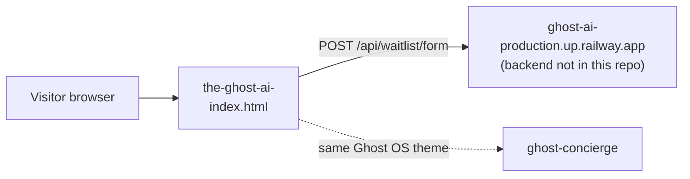

# the-ghost-ai-

Static marketing page for "Ghost AI - Your Private AI You Can Call or Text", with a waitlist form.

## What it is

A one-page website pitching a private AI assistant you reach by phone call or text, at a
listed price of $20 per month. It is marketing only. The product it describes is not implemented in this
branch. A much larger prototype of the related "Ghost OS / A NEXT GENT" idea (a box plus an Android
phone that operates apps) lives on a separate, unmerged branch, `claude/redhat-model-hardware-sales-iejnvo`,
which describes itself as unproven on real hardware.

## How it works

- `index.html` (about 500 lines) is the whole site: hero, pricing, FAQ and a waitlist form (`#waitlistForm`).
- The form's script sends name, phone, email, AI preference and SMS consent with `fetch` to
  `https://ghost-ai-production.up.railway.app/api/waitlist/form`. That backend is not in this repo
  (presumably the `ghost-ai` repo); whether it is still live is unverified.
- Assets: `hero-video.mp4`, `ghost-os-feature.png`, `how-ghost-os-works.png`, `favicon.svg`.
- No build step, no package manifest.

## Run it

Open `index.html` in a browser, or serve the folder with any static server, for example
`python3 -m http.server`. No environment variables. The waitlist submit only works if the
external backend above is reachable.

## Status

Stalled: `main` is a landing page from a single January 2026 commit, and the real work sits on an unmerged branch.

## Where it fits

## Related repos

- `ghost-ai`: the likely home of the Railway-hosted waitlist backend.
- `ghost-concierge`: a sibling marketing page that shares the Ghost OS theme.
- `nextgent-flows`: uses the same box / daemon / capabilities vocabulary as the prototype branch.
